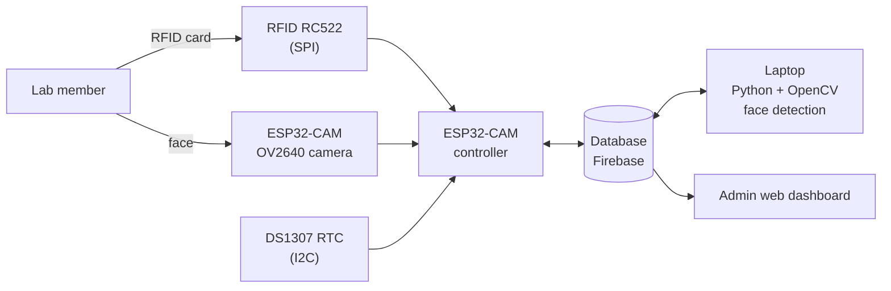

# RFID and Facial Recognition-Based Lab Management System

A lab access and attendance system built on the ESP32-CAM. A member checks in with an RFID card, and the system also captures a photo to verify the person's face. A member who forgot the card can check in with face recognition alone. Records and photos are shown on an admin web dashboard.

Course project (January 2025), team of 2.

## Demo

> [Add 3–4 images here: the finished hardware, the dashboard, the live status page, the card registration page. Add a short demo video link if you have one.]
<p align="center">
  <br>
  <em>Figure 1. Hardware prototype: RFID-RC522 reader wired to an ESP32 on a screw-terminal breakout board.</em>
</p>

<p align="center">
  <br>
  <em>Figure 2. Admin dashboard (Vietnamese interface): check-in / check-out log with card UID, member name, department, email, time and status.</em>
</p>

<p align="center">
  <br>
  <em>Figure 3. Firebase Realtime Database: employee records keyed by RFID card UID, plus the attendance log.</em>
</p>

## Features

- **Two ways to check in**: swipe an RFID card, or use face capture when the card is forgotten.
- **Two security layers**: the physical card and the face verified against a stored reference photo, which helps prevent someone swiping a friend's card.
- **Reference photo**: one frontal photo is stored for each member at registration.
- **Accurate timestamps** for every entry and exit, from a real-time clock (DS1307).
- **Unknown card handling**: an unrecognised card shows an "unknown card" message and returns to the mode selection.
- **Admin web dashboard**: member list, card registration, check-in and check-out log, live status, and the captured photo for each scan.

## How it works

1. At start-up the user chooses a mode: **RFID** or **face capture**.
2. **RFID mode**: the member swipes a card. If the card is known, the ESP32-CAM captures a photo, the system checks the member's information, and the entry is recorded.
3. **Face mode**: the ESP32-CAM captures a photo and the system compares it with the stored faces to identify the member.
4. The record (card ID, time, status, photo) is stored in the database and appears on the dashboard.



## Hardware

| Part | Role |
|------|------|
| ESP32-CAM (OV2640 camera) | Main controller; captures JPEG photos; WiFi connection |
| RFID RC522 module | Reads the card, 13.56 MHz, SPI interface |
| DS1307 RTC module | Real-time clock, I2C interface |
| Buzzer / indicators | [Add if used] |

> [Add the schematic and PCB images under `docs/` if they are yours to share. The project report covers PCB design in Altium Designer.]

## Software

- **Firmware** for the ESP32-CAM: card reading, photo capture, communication with the database. [Arduino IDE / PlatformIO: confirm]
- **Face detection** with OpenCV, using the **Haar Cascade frontal face** classifier (grayscale conversion, sliding window, cascade stages, overlapping detections merged). [Add one line on how the captured face is matched with the stored reference photo.]
- **Web dashboard** for administrators, backed by Firebase. Main pages:
  - Lab management: card UID, name, department, email, scan time, status.
  - Live status: green for check-in, red for check-out.
  - Member list and card registration form.

## Project structure

> [Adjust to match your folders.]

```
.
├── firmware/        # ESP32-CAM code
├── face-recognition/  # Python + OpenCV scripts
├── web/             # admin dashboard
├── hardware/        # schematic, PCB, photos
└── docs/            # block diagram, screenshots
```

## Getting started

> [Fill in the real steps. A short, working list is enough.]

1. Flash the firmware to the ESP32-CAM and set your WiFi and database settings in [file name].
2. Create a Firebase project and add its configuration to [file name].
3. Install the Python requirements (`pip install opencv-python ...`) and run [script name].
4. Open the dashboard at [URL / file].

> Never commit WiFi passwords or Firebase keys. Keep them in a local config file listed in `.gitignore` and provide an example file instead.

## My role

I worked on the software (web dashboard and face matching) and on the hardware assembly: wiring and mounting the modules.
My teammate, Nguyễn Thanh Tuấn, built the hardware..

## Authors

- Phạm Minh Tiến
- Nguyễn Thanh Tuấn
